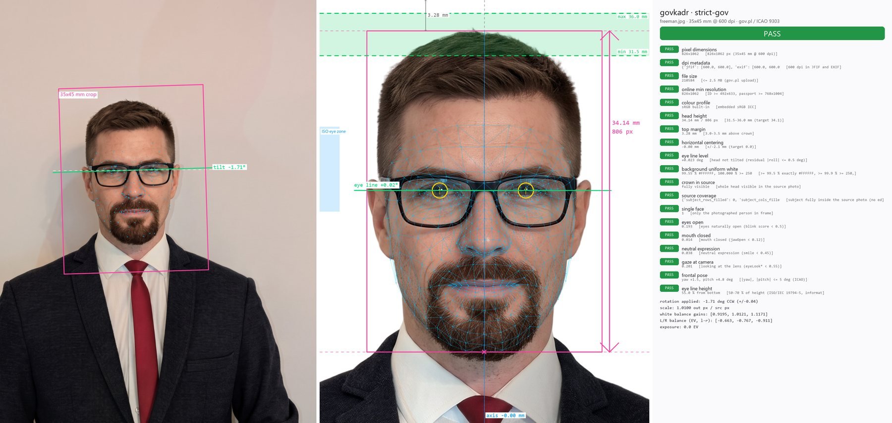
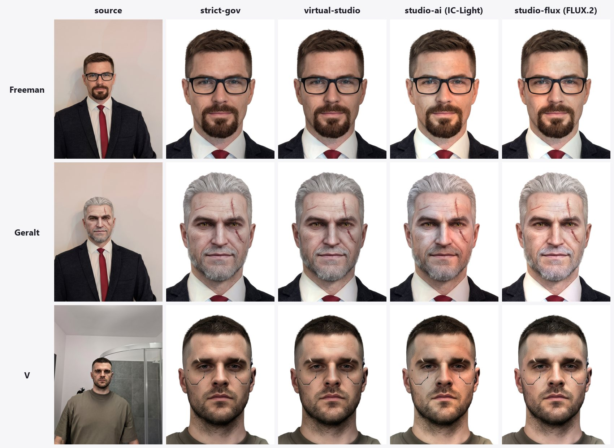
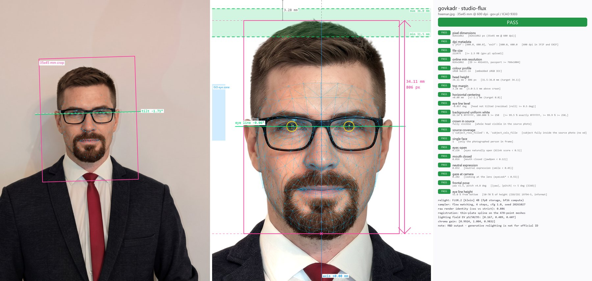
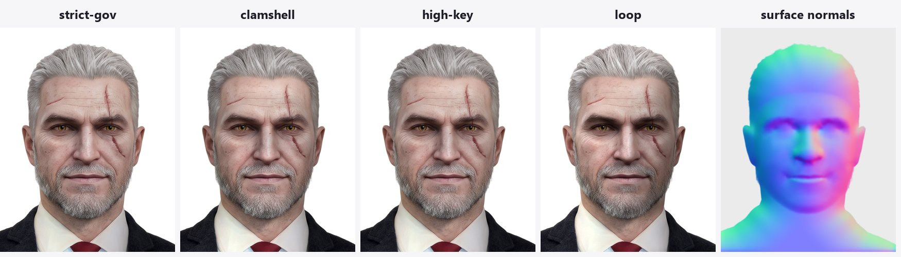
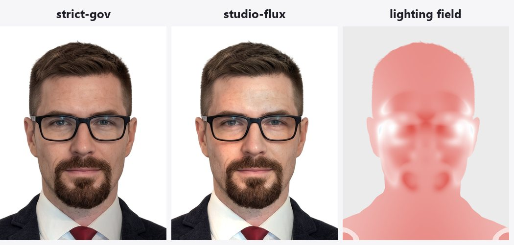
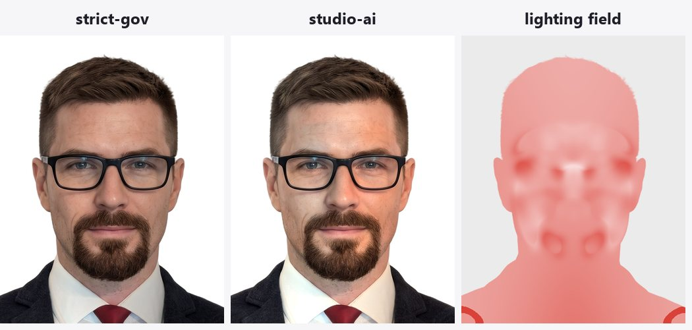
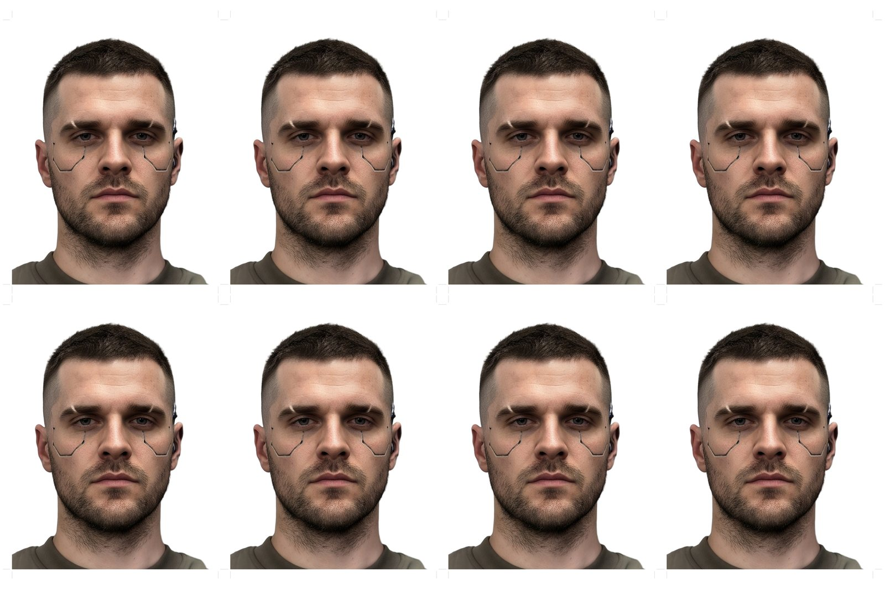
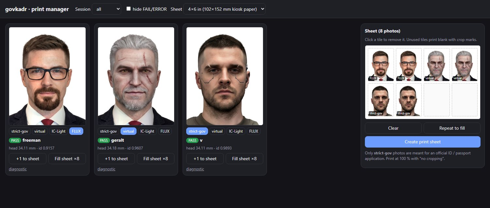
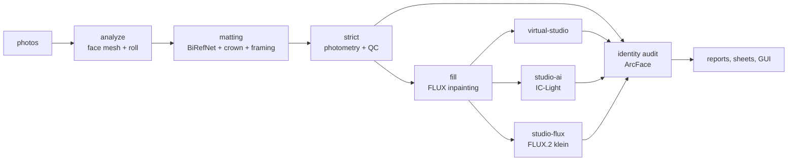

# govkadr

[](https://github.com/olekkut/govkadr/actions/workflows/ci.yml)
[](LICENSE)


**Turn phone portraits into compliant 35 × 45 mm photos for Polish ID cards and passports**
(gov.pl *Zdjęcie do dowodu lub paszportu*, ICAO Doc 9303), fully locally, with every requirement
re-measured on the delivered file.


<sub>Every photo gets a diagnostic sheet: the detected tilt and crop on the source (left), the finished
35 × 45 mm photo with face mesh, levelled eye line, crown-to-chin box and head-height zone (middle), and
every check re-measured on the saved file (right). The example is an AI-edited portrait.</sub>

govkadr is a command-line pipeline plus a small local GUI. Point it at a folder of photos and it produces,
for each one, a print-ready 826 × 1062 px / 600 dpi photo, kiosk print sheets with crop marks, an annotated
diagnostic sheet and a JSON compliance report. Optional studio modes relight the photo, and an identity
audit measures how much each mode changed the face.

## Highlights

- **Precise geometry.** A 478-point face mesh (MediaPipe) with test-time augmentation levels the
  eye line from the iris centres (±0.05° uncertainty), and the crown is taken from the hair silhouette,
  not the forehead. One composed, anti-aliased transform gives a 34.1 mm chin-to-crown head height,
  a 3.25 mm top margin and a centred facial axis.
- **Clean cut-out.** BiRefNet matting keeps individual hair strands, and foreground colour estimation
  stops halos, onto a background that is exactly `#FFFFFF`.
- **Non-destructive correction.** White balance, exposure and left/right lighting balance are smooth
  multiplicative fields, so pores, moles and scars stay exactly as photographed.
- **Verified, not assumed.** Head height, margins, centring, roll, background, pose, expression, DPI
  metadata, colour profile and file size are re-measured on the saved JPEG.
- **Studio relighting**, three ways:
  - `virtual-studio`: physically based virtual softboxes (clamshell, high-key, loop) applied to 3D face
    geometry. No generative model, no generated pixel.
  - `studio-ai` (IC-Light) and `studio-flux` (FLUX.2 [klein] 4B): diffusion models used only as a
    lighting source. Their render is registered to the real face, only the smooth lighting field is
    transferred, and the render is discarded.
- **Identity-drift audit.** ArcFace cosine similarity of every output to its source, calibrated
  against the natural variation between your own photos.
- **Edge fill.** When a shoulder is cut by the frame, only the missing strip of clothing is
  generated, guided by your best-framed shot from the same session. Official output is never filled.
- **Print manager.** A local GUI to pick photos (any mix) and build 10 × 15 cm or 4 × 6 in sheets.
- **Runs on an 8 GB laptop GPU.** Each model runs in its own process, weights stream from disk,
  diffusion weights are stored in FP8, and stages wait for free memory or skip themselves rather
  than crash other apps.

## How it works, by example

The example inputs in [`examples/input`](examples/input) are AI-edited portraits (the author's photos
restyled as Gordon Freeman, Geralt of Rivia and V). They include glasses, grey hair with a scar, and a
cluttered bathroom background.

### Every mode, side by side



All twelve photos pass the compliance checks: head height 34.1–34.2 mm, axis offset ≤ 0.01 mm,
background exactly white. V's shower, tiles and shelf are removed entirely.

Identity similarity to the source (ArcFace cosine, 1.0 = identical) shows how far each mode moves away
from the original face:

| | strict-gov | virtual-studio | studio-flux | studio-ai |
|---|---|---|---|---|
| Freeman | 0.981 | 0.958 | 0.916 | 0.938 |
| Geralt | 0.987 | 0.961 | 0.962 | 0.929 |
| V | 0.989 | 0.944 | 0.933 | 0.919 |

### Diagnostic sheet

Every output comes with an annotated sheet like a commercial biometric scanner's (the strict-gov
one is shown at the top of this page): the detected tilt and crop on the source; the 478-point mesh,
iris fits, levelled eye line, crown-to-chin box, the 31.5–36 mm compliance zone and the centring axis;
and every check re-measured on the saved file. The relighting modes get the same sheet:

<details>
<summary>studio-flux diagnostic sheet</summary>



</details>

### Relighting modes

**virtual-studio**: physically based light on 3D face geometry, with no generative model. From left:
strict-gov input, the three light setups, and the surface normals they are computed on.



**studio-flux** and **studio-ai**: a diffusion model relights the photo, but only its smooth lighting
field (right) is applied to the real photo, so skin texture, scars and stubble stay the camera's.




### Print sheet and print manager

Each photo also comes as a 10 × 15 cm (and 4 × 6 in) sheet of 8 with crop marks:



`govkadr gui` lets you mix any photos and modes on one sheet:



Regenerate these figures with `uv run python scripts/make_readme_figures.py` after running the
pipeline on `examples/input` into `output-examples`.

## Modes

| Mode | What changes | Intended use |
|---|---|---|
| `strict-gov` | geometry, background, smooth exposure / white balance / left-right balance | **official submission** |
| `virtual-studio` | + physically computed softbox lighting | studio portraits (clamshell / high-key are ID-style) |
| `studio-ai` | + lighting field from IC-Light (SD 1.5) | research, not for official use |
| `studio-flux` | + lighting field from FLUX.2 [klein] 4B | research, not for official use |

## Pipeline



Each stage runs in its own process and resumes per photo from `output/.cache/`.
[ARCHITECTURE.md](ARCHITECTURE.md) explains every design decision, model choice and measurement.

## Requirements

- Windows 10/11 or Linux, Python 3.12 (installed by [uv](https://docs.astral.sh/uv/))
- NVIDIA GPU with ≥ 6 GB VRAM and a recent driver (tested on an RTX 5060 Laptop GPU, 8 GB, Blackwell)
- ~3 GB of disk for the core models, ~19 GB with FLUX.2 [klein]
- For `studio-flux` and edge fill: ~9 GB of free system memory (RAM + page file)

## Quick start

```bash
git clone https://github.com/olekkut/govkadr.git
cd govkadr
uv sync
uv run govkadr fetch-models          # add --flux for FLUX.2 [klein] (~16 GB)
uv run govkadr run --input path/to/photos --output output
uv run govkadr gui                   # pick photos and build a print sheet
```

Useful options for `govkadr run`:

| Option | Effect |
|---|---|
| `--mode all\|strict-gov\|virtual-studio\|studio-ai\|studio-flux` | which outputs to produce (default `all`) |
| `--preset clamshell\|high-key\|loop` | virtual-studio light setup |
| `--only <name fragments>` / `--limit N` | process a subset |
| `--from-stage <stage>` / `--stages <stage ...>` | re-run part of the pipeline, reusing the cache |
| `--allow-low-memory` | run the generative stages even when free memory is short |

## Outputs

```
output/
  index.html, summary.md, summary.json      gallery and one row per photo
  prints/                                   sheets built in the GUI
  <photo>/
    report.json                             every measurement, check and model setting
    strict-gov/
      <photo>_strict-gov_35x45mm_600dpi.jpg  826 x 1062 px, 600 dpi, sRGB  <- submit / print this
      <photo>_strict-gov_sheet_10x15cm.jpg   150 x 100 mm, 8 copies, crop marks
      <photo>_strict-gov_sheet_4x6in.jpg     4 x 6 in (most "10x15" kiosks), 8 copies
      <photo>_strict-gov_diagnostic.jpg      mesh, axes, compliance zone, checklist
    virtual-studio/   ... + _presets.jpg (all three light setups)
    studio-ai/, studio-flux/   ... + _comparison.jpg (before | after | lighting field)
```

**Printing:** most "10 × 15" photo kiosks actually use 4 × 6 in paper. Print `sheet_4x6in` there
(or `sheet_10x15cm` on true 150 × 100 mm paper) at 100 % / "no cropping", and cut along the grey marks.

## Taking a good source photo

- Use a telephoto lens (2–5× on a phone) from 1.5–2 m: wide-angle close-ups distort the nose and jaw.
- Plain wall, soft light from the front (a window behind the photographer), camera level with the eyes.
- Leave space above the hair and below the shoulders.

## Privacy

Everything runs locally. Photos, outputs and model weights are git-ignored, and the GUI listens on
127.0.0.1 only. Output JPEGs carry no camera or GPS metadata.

## Development

```bash
uv sync --group dev
uv run pytest
uv run ruff check . && uv run ruff format --check .
```

The unit tests need no GPU or model weights; CI runs them on every push.

## Licence and disclaimer

The code is [MIT-licensed](LICENSE). The downloaded models have their own licences, including a
non-commercial restriction on the InsightFace models used by the identity audit. See
[THIRD_PARTY_MODELS.md](THIRD_PARTY_MODELS.md).

govkadr checks photos against published requirements, but the issuing office makes the final
decision. Only `strict-gov` output is intended for official applications.
